# Rewind database ER diagram

This diagram describes the schema after Flyway migrations **V1–V24**. The migration files in `src/main/resources/db/migration` remain the source of truth; this document is the review and presentation artifact.

```mermaid
erDiagram
    USERS {
        BIGINT id PK
        VARCHAR username UK
        VARCHAR email UK
        ENUM role
        BOOLEAN is_active
        BOOLEAN is_hq
    }
    MOVIES {
        BIGINT id PK
        BIGINT tmdb_id UK
        VARCHAR imdb_id UK
        VARCHAR title
        DATE release_date
        DECIMAL rating
        VARCHAR trailer_url
    }
    ACTORS { BIGINT id PK VARCHAR name BIGINT tmdb_id UK }
    DIRECTORS { BIGINT id PK VARCHAR name BIGINT tmdb_id UK }
    GENRES { BIGINT id PK VARCHAR name UK BIGINT tmdb_id UK }
    MOVIE_ACTORS { BIGINT movie_id PK BIGINT actor_id PK VARCHAR character_name INT cast_order }
    MOVIE_DIRECTORS { BIGINT movie_id PK BIGINT director_id PK }
    MOVIE_GENRES { BIGINT movie_id PK BIGINT genre_id PK }
    LISTS { BIGINT id PK BIGINT user_id FK ENUM list_type BOOLEAN is_public }
    LIST_ITEMS { BIGINT id PK BIGINT list_id FK BIGINT movie_id FK INT position }
    REVIEWS { BIGINT id PK BIGINT user_id FK BIGINT movie_id FK TINYINT rating BOOLEAN is_hidden BIGINT moderated_by FK }
    REVIEW_ARCHIVE { BIGINT id PK BIGINT user_id BIGINT movie_id }
    RATINGS { BIGINT id PK BIGINT user_id FK BIGINT movie_id FK TINYINT rating }
    EXTERNAL_RATINGS { BIGINT id PK BIGINT movie_id FK ENUM source DECIMAL rating INT votes_count }
    SIMILAR_MOVIES { BIGINT movie_id PK BIGINT similar_movie_id PK }
    COMMENTS { BIGINT id PK BIGINT review_id FK BIGINT user_id FK BOOLEAN is_hidden BIGINT moderated_by FK }
    FOLLOWS { BIGINT id PK BIGINT follower_id FK BIGINT following_id FK }
    REVIEW_LIKES { BIGINT id PK BIGINT review_id FK BIGINT user_id FK }
    USER_ACTIVITIES { BIGINT id PK BIGINT user_id FK BIGINT movie_id FK BIGINT review_id FK BIGINT list_id FK BIGINT related_user_id FK }
    TAGS { BIGINT id PK VARCHAR name VARCHAR slug UK }
    LIST_TAGS { BIGINT list_id PK BIGINT tag_id PK }
    NOTIFICATIONS { BIGINT id PK BIGINT recipient_id FK BIGINT actor_id FK BIGINT related_user_id FK BIGINT review_id FK VARCHAR notification_type TIMESTAMP read_at }
    NOTIFICATION_PREFERENCES { BIGINT user_id PK BOOLEAN follows_enabled BOOLEAN review_likes_enabled }
    PASSWORD_RESET_TOKENS { BIGINT id PK BIGINT user_id FK VARCHAR token_hash UK TIMESTAMP expires_at TIMESTAMP used_at }
    REFRESH_SESSIONS { BIGINT id PK BIGINT user_id FK VARCHAR token_hash UK TIMESTAMP expires_at TIMESTAMP revoked_at }
    CONVERSATIONS { BIGINT id PK BIGINT user_one_id FK BIGINT user_two_id FK }
    MESSAGES { BIGINT id PK BIGINT conversation_id FK BIGINT sender_id FK TIMESTAMP read_at }
    ADMIN_AUDIT_LOGS { BIGINT id PK BIGINT admin_id FK VARCHAR action VARCHAR target_type BIGINT target_id }
    JOURNAL_ARTICLES { BIGINT id PK VARCHAR slug VARCHAR language VARCHAR category BIGINT author_id FK VARCHAR audio_url BOOLEAN is_published }
    SITE_SETTINGS { VARCHAR setting_key PK VARCHAR setting_value BIGINT updated_by FK }

    USERS ||--o{ LISTS : owns
    LISTS ||--o{ LIST_ITEMS : contains
    MOVIES ||--o{ LIST_ITEMS : appears_in
    USERS ||--o{ REVIEWS : writes
    MOVIES ||--o{ REVIEWS : receives
    USERS ||--o{ RATINGS : gives
    MOVIES ||--o{ RATINGS : receives
    MOVIES ||--o{ EXTERNAL_RATINGS : has
    MOVIES ||--o{ SIMILAR_MOVIES : source
    MOVIES ||--o{ SIMILAR_MOVIES : similar
    MOVIES ||--o{ MOVIE_ACTORS : cast
    ACTORS ||--o{ MOVIE_ACTORS : appears_in
    MOVIES ||--o{ MOVIE_DIRECTORS : crew
    DIRECTORS ||--o{ MOVIE_DIRECTORS : directs
    MOVIES ||--o{ MOVIE_GENRES : categorized
    GENRES ||--o{ MOVIE_GENRES : classifies
    REVIEWS ||--o{ COMMENTS : has
    USERS ||--o{ COMMENTS : writes
    USERS ||--o{ FOLLOWS : follows
    USERS ||--o{ FOLLOWS : followed_by
    REVIEWS ||--o{ REVIEW_LIKES : receives
    USERS ||--o{ REVIEW_LIKES : gives
    USERS ||--o{ USER_ACTIVITIES : creates
    MOVIES ||--o{ USER_ACTIVITIES : references
    REVIEWS ||--o{ USER_ACTIVITIES : references
    LISTS ||--o{ USER_ACTIVITIES : references
    USERS ||--o{ USER_ACTIVITIES : relates_to
    LISTS ||--o{ LIST_TAGS : tagged
    TAGS ||--o{ LIST_TAGS : used_by
    USERS ||--o{ NOTIFICATIONS : receives
    USERS ||--o{ NOTIFICATIONS : triggers
    USERS ||--o{ NOTIFICATIONS : related_user
    REVIEWS ||--o{ NOTIFICATIONS : references
    USERS ||--o| NOTIFICATION_PREFERENCES : configures
    USERS ||--o{ PASSWORD_RESET_TOKENS : resets
    USERS ||--o{ REFRESH_SESSIONS : sessions
    USERS ||--o{ CONVERSATIONS : participates
    CONVERSATIONS ||--o{ MESSAGES : contains
    USERS ||--o{ MESSAGES : sends
    USERS ||--o{ ADMIN_AUDIT_LOGS : performs
    USERS ||--o{ JOURNAL_ARTICLES : authors
    USERS ||--o{ SITE_SETTINGS : updates
```



`REVIEW_ARCHIVE` is retained by migration V5 for historical duplicate reviews and is not referenced by the runtime API. `SIMILAR_MOVIES` is a self-referencing join table. Nullable moderator/author references use `ON DELETE SET NULL`; user-owned content uses the cascade rules declared in the migrations.

## Verification

With the development Compose database running, execute:

```powershell
./scripts/verify-er-schema.ps1
```

The script checks that every table represented above exists in the `rewind` schema and that the database exposes the expected foreign-key relationship count.
