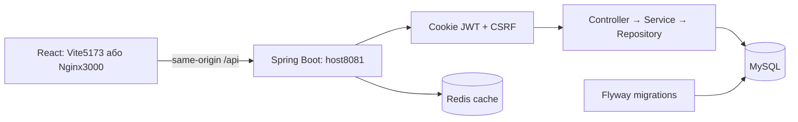

# Rewind

Двомовна платформа для пошуку фільмів, оцінок, оглядів, списків і спілкування. Frontend — React/TypeScript/Vite; backend — Java 17/Spring Boot; дані — MySQL 8.4 і Redis, локальна пошта — Mailpit.

## Запуск

Із кореня репозиторію, у PowerShell із запущеним Docker Desktop:

```powershell
.\scripts\init-dev-env.ps1
docker compose up -d --build
```

Сайт: `http://localhost:3000/uk/home`. Для роботи з актуальним frontend-кодом:

```powershell
cd frontend
npm ci
npm run dev -- --host 127.0.0.1
```

Dev frontend: `http://127.0.0.1:5173/uk/home`, API: `http://127.0.0.1:8081`, Mailpit: `http://localhost:8025`. Порт 3000 показує зібраний Docker image, 5173 — поточний source. Налаштування та усунення проблем — [RUN_LOCAL](docs/operations/RUN_LOCAL.md).

## Структура

```text
backend/   Java/Maven: src/, pom.xml, mvnw, .mvn/, Dockerfile
frontend/  React/Vite: src/, public/, package.json, Dockerfile
docs/      backend/, frontend/, operations/, project/, diploma/
scripts/   перевірки, backup/restore, операції середовища й генератор демоданих
```

Compose, CI, Caddy й локальний `.env` розташовані в корені. Java редагується в `backend/src/`, React — у `frontend/src/`. `target/`, `dist/`, `node_modules/`, test-results та `artifacts/` містять generated/dependency/evidence файли; `.class` не є вихідним Java-кодом.

У `scripts/`: `init-dev-env.ps1` готує локальний `.env`; `backup-*` і `restore-*` працюють із копіями БД; `verify-*` перевіряють API, схему, безпеку й конфігурацію; `capture-diploma-*` створюють матеріали захисту; `tmdb_seed_50.py` генерує демо SQL. `sync-figma.ps1` потребує окремого зовнішнього exporter. Точні команди запуску й вплив перевірок на тестові дані описані в [RUN_LOCAL](docs/operations/RUN_LOCAL.md).

## Архітектура



Routes мають `/uk` або `/en`. Авторизація використовує HttpOnly access/refresh cookies; mutations потребують CSRF cookie/header. Backend перевіряє role, ownership і block rules. API та UI зберігають реальні loading/error/empty/retry стани.

## Де шукати функцію

UI-файли — від `frontend/src/`, Java packages — від `backend/src/main/java/com/rewind/rewind/`.

| Функція | Frontend | Backend |
| --- | --- | --- |
| Каталог, пошук, фільми й персоналії | `Home`, `Search`, `GlobalSearch`, `MovieDetails`, `Person` | `movie`, `search`, `person`, `actor`, `director`, `producer`, `tmdb` |
| Профіль і налаштування | `Profile`, `PublicProfile` | `profile`, `user`, `rating` |
| Списки, теги, вподобання | `UserLists`, `PublicLists`, `PublicList` | `list`, `tag` |
| Огляди й коментарі | `PopularReviews`, `ReviewDetails`, `Comments` | `review`, `comment`, `rating`, `social` |
| Community, повідомлення, сповіщення | `Community`, `PopularReviewers`, `Messages`, `Notifications` | `social`, `message`, `notification` |
| Journal і newsletter | `Journal`, `JournalArticle`, `AdminArticles` | `journal`, `newsletter` |
| Авторизація та службові сторінки | `auth/`, `ServicePage`, `About` | `auth`, `security`, `user` |
| Адміністрування | `AdminDashboard`, `components/Admin*` | `admin` і domain services |

## Документація

| Потрібно | Джерело |
| --- | --- |
| Наступні задачі / короткий стан | [PLAN](PLAN.md) / [PROGRESS](docs/project/PROGRESS.md) |
| Вимоги та відповідність реалізації | [ТЗ](docs/project/PROJECT_REQUIREMENTS.md), [таблиця відповідності](docs/project/PROJECT_REQUIREMENTS.md#implementation-status) |
| Java, модель даних і HTTP контракти | [Backend і ER-схема](docs/backend/README.md), [API](docs/backend/API.md) |
| React routes, спільні компоненти, дизайн | [Frontend](docs/frontend/README.md), [Figma handoff](docs/frontend/FIGMA_HANDOFF.md) |
| Запуск / production / перевірки | [RUN_LOCAL](docs/operations/RUN_LOCAL.md), [DEPLOYMENT](docs/operations/DEPLOYMENT.md), [RELEASE_EVIDENCE](docs/operations/RELEASE_EVIDENCE.md) |
| Захист диплома | [Матеріали](docs/diploma/DIPLOMA_MATERIALS.md) |

Перевірка frontend: `npm run verify:build` із `frontend/`. Maven запускати з `backend/`; integration/browser suites працюють із виділеною тестовою БД, інструкції — в RUN_LOCAL. Secrets зберігаються локально поза Git; наявні Flyway migrations не переписуються.
