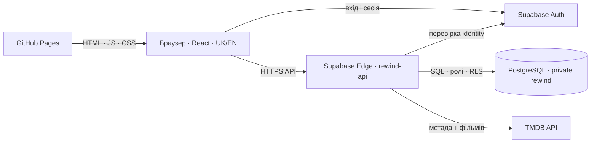
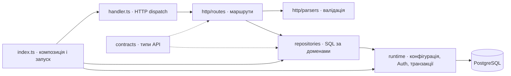
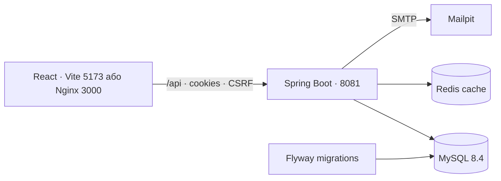

# REWIND

Двомовна UK/EN платформа для пошуку фільмів, оцінок, оглядів, власних списків і спілкування. Публічний застосунок використовує React/TypeScript/Vite, GitHub Pages і Supabase. [Відкрити REWIND](https://anton5267.github.io/rewind-letterboxd/).

Поточний стан, відкриті функціональні прогалини й межі приймання зібрані в [PLAN](PLAN.md), [PROGRESS](docs/project/PROGRESS.md) та [вимогах](docs/project/PROJECT_REQUIREMENTS.md). Результати перевірок зберігаються в [RELEASE_EVIDENCE](docs/operations/RELEASE_EVIDENCE.md).

## Архітектура

### Публічний застосунок



Для захищених запитів frontend передає Supabase access token. Edge перевіряє identity та права доступу, зіставляє профіль за Supabase UUID і зберігає числові REWIND IDs та ролі. Таблиці застосунку розташовані в приватній схемі `rewind` з RLS і вузькими grants.

### Організація Edge API



Маршрути отримують repository-інтерфейс через контекст. `contracts/` містить типи для перевірки TypeScript. У `repositories/` код згрупований за каталогом, профілями, списками, відгуками, social, повідомленнями та Admin-функціями.

Повторне розгортання використовує повний TypeScript source із Git разом із `deno.json` та всіма відносними імпортами, включно з type-only модулями. План відновлення сервісів описаний у [Supabase operations](docs/operations/SUPABASE_OPERATIONS.md).

### Локальне середовище



Spring використовує HttpOnly access/refresh cookies, CSRF та перевірки ролей, ownership і block rules. Локальні MySQL-дані й hosted PostgreSQL-дані мають окремий життєвий цикл. Локальні акаунти та приватні записи потребують перевіреного перенесення за runbook.

## Локальний запуск

Із кореня репозиторію в PowerShell із запущеним Docker Desktop

```powershell
.\scripts\init-dev-env.ps1
docker compose up -d --build
```

Для редагування frontend-коду із запущеним локальним API

```powershell
cd frontend
npm ci
npm run dev -- --host 127.0.0.1
```

| Сервіс | Адреса |
| --- | --- |
| Frontend із Docker image | `http://localhost:3000/uk/home` |
| Frontend із поточного source | `http://127.0.0.1:5173/uk/home` |
| Spring API | `http://127.0.0.1:8081` |
| Mailpit inbox | `http://localhost:8025` |

У VS Code відкривай корінь репозиторію, а Maven-команди виконуй із `backend/`. Параметри середовища, підготовка даних та усунення проблем описані в [RUN_LOCAL](docs/operations/RUN_LOCAL.md).

## Структура коду

```text
frontend/src/
  pages/                  сторінки й маршрутна композиція
    profile/              тематичні CSS-частини профілю
  components/             повторно використовувані UI-компоненти
  api/                    HTTP-клієнти й контракти frontend
backend/                  Java/Maven · src/, pom.xml, mvnw, .mvn/
supabase/
  functions/rewind-api/
    index.ts              запуск і композиція залежностей
    handler.ts            сумісна HTTP-точка входу
    contracts/            доменні request/response типи
    http/                 маршрути, парсери й HTTP-відповіді
    repositories/         доменні SQL-операції
    runtime/              DB pools, Auth, транзакції, TMDB worker
  migrations/             версійні hosted PostgreSQL-міграції
scripts/                  середовище, операційні перевірки, backup/restore
docs/                     вимоги, API, дизайн, операційні інструкції
```

Compose, CI, Caddy та локальний `.env` містяться в корені. `target/`, `dist/`, `node_modules/`, `test-results/` і `artifacts/` використовуються для результатів збірки, залежностей та доказів перевірок.

## Перевірки й робота з даними

- Frontend typecheck і production build запускаються командою `npm run verify:build` із `frontend/`.
- Edge API з установленим Deno перевіряється командами `deno check index.ts` і `deno test` із `supabase/functions/rewind-api/`.
- Maven-команди виконуються з `backend/`. Integration/browser сценарії потребують підготовленого тестового середовища. [Інструкції перевірок](docs/operations/RUN_LOCAL.md).
- Supabase server keys, DB passwords, SMTP credentials та одноразові Auth-посилання зберігати поза Git, frontend і логами. Публічний build отримує лише призначені для клієнта параметри.
- Існуючі Flyway-міграції зберігаються незмінними. Перенесення даних потребує зашифрованого backup, звірки рядків/IDs/FK/sequences та перевіреного rollback. Окремо планується відновлення Auth identities, Storage і секретів. [PostgreSQL backup/restore](docs/operations/DEPLOYMENT_POSTGRESQL.md), [Supabase operations](docs/operations/SUPABASE_OPERATIONS.md).
- Hosted SQL у `supabase/migrations/` має власну історію застосування. MySQL Flyway-історія та PostgreSQL baseline описані в [runbook перенесення](docs/operations/DEPLOYMENT_POSTGRESQL.md).

## Документація

| Потрібно | Джерело |
| --- | --- |
| Порядок роботи та поточний стан | [PLAN](PLAN.md), [PROGRESS](docs/project/PROGRESS.md) |
| Вимоги та реалізація | [PROJECT_REQUIREMENTS](docs/project/PROJECT_REQUIREMENTS.md) |
| Java, модель даних, HTTP-контракти | [Backend і ER-схема](docs/backend/README.md), [API](docs/backend/API.md) |
| React routes, компоненти, Figma | [Frontend](docs/frontend/README.md), [Figma handoff](docs/frontend/FIGMA_HANDOFF.md) |
| Розгортання й експлуатація | [DEPLOYMENT](docs/operations/DEPLOYMENT.md), [Supabase operations](docs/operations/SUPABASE_OPERATIONS.md) |
| Докази приймання й відомі обмеження | [RELEASE_EVIDENCE](docs/operations/RELEASE_EVIDENCE.md) |
| Матеріали захисту диплома | [DIPLOMA_MATERIALS](docs/diploma/DIPLOMA_MATERIALS.md) |
