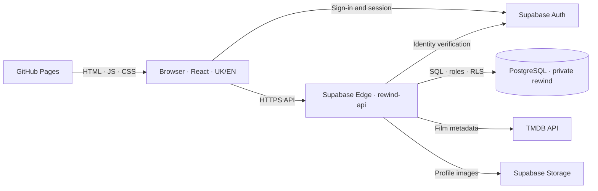
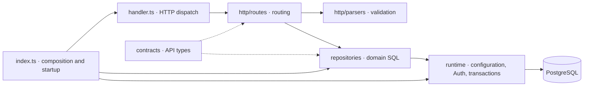
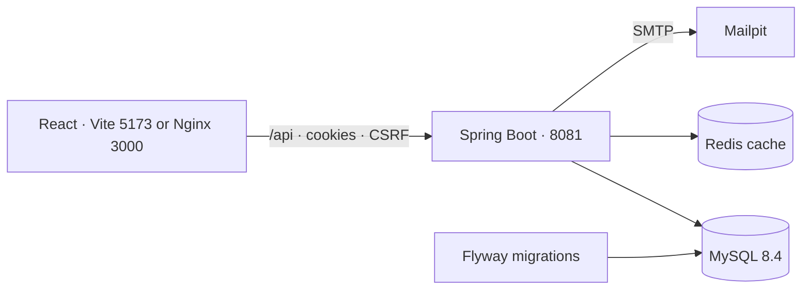

# REWIND

A bilingual Ukrainian/English platform for discovering films, rating and reviewing them, creating lists, and connecting with other members. The public application uses React, TypeScript, Vite, GitHub Pages, and Supabase. [Open REWIND](https://anton5267.github.io/rewind-letterboxd/).

Current status, feature gaps, and acceptance criteria are tracked in [PLAN](PLAN.md), [PROGRESS](docs/project/PROGRESS.md), and the [project requirements](docs/project/PROJECT_REQUIREMENTS.md). Verification results are recorded in [RELEASE_EVIDENCE](docs/operations/RELEASE_EVIDENCE.md).

## Architecture

### Public application



The frontend sends a Supabase access token with protected requests. Edge verifies identity and permissions, maps profiles by Supabase UUID, and preserves numeric REWIND IDs and roles. Application tables live in the private `rewind` schema with row-level security and narrowly scoped grants. Public avatar and banner files use Supabase Storage, with owner-verified uploads and retryable server-side cleanup.

### Edge API organization



Routes receive the repository interface through their context. `contracts/` provides types for TypeScript checking. `repositories/` groups operations by catalogue, profiles, lists, reviews, social features, messaging, and administration.

Redeployment uses the complete TypeScript source from Git, including `deno.json`, relative imports, and type-only modules. Service recovery procedures are documented in [Supabase operations](docs/operations/SUPABASE_OPERATIONS.md).

### Local environment



Spring uses HttpOnly access/refresh cookies, CSRF protection, and role, ownership, and blocking checks. Local MySQL data and hosted PostgreSQL data have separate lifecycles. Migrating local accounts and private records requires the verified procedures in the migration runbook.

## Local development

From the repository root, run these commands in PowerShell with Docker Desktop running.

```powershell
.\scripts\init-dev-env.ps1
docker compose up -d --build
```

To edit frontend code with the local API running, start Vite from `frontend/`.

```powershell
cd frontend
npm ci
npm run dev -- --host 127.0.0.1
```

| Service | Address |
| --- | --- |
| Frontend from the Docker image | `http://localhost:3000/uk/home` |
| Frontend from the current source | `http://127.0.0.1:5173/uk/home` |
| Spring API | `http://127.0.0.1:8081` |
| Mailpit inbox | `http://localhost:8025` |

Open the repository root in VS Code and run Maven commands from `backend/`. Environment configuration, data preparation, and troubleshooting are covered in [RUN_LOCAL](docs/operations/RUN_LOCAL.md).

## Code structure

```text
frontend/src/
  pages/                  pages and route composition
    profile/              own-profile hooks, views, and CSS
    public-profile/       public-profile hooks, views, and CSS
  components/             reusable UI components
  api/                    HTTP clients and frontend contracts
backend/                  Java/Maven · src/, pom.xml, mvnw, .mvn/
supabase/
  functions/rewind-api/
    index.ts              startup and dependency composition
    handler.ts            compatible HTTP entry point
    contracts/            domain request/response types
    http/                 routes, parsers, and HTTP responses
    repositories/         domain SQL operations
    runtime/              DB pools, Auth, transactions, TMDB worker
  migrations/             versioned hosted PostgreSQL migrations
scripts/                  environment, operational checks, backup/restore
docs/                     requirements, API, design, and operations
```

Compose, CI, Caddy, and the local `.env` reside at the repository root. `target/`, `dist/`, `node_modules/`, `test-results/`, and `artifacts/` contain build outputs, dependencies, and verification artifacts.

## Checks and data operations

- Run frontend type checking and the production build with `npm run verify:build` from `frontend/`.
- With Deno installed, check the Edge API using `deno check index.ts` and `deno test` from `supabase/functions/rewind-api/`.
- Run Maven commands from `backend/`. Integration and browser scenarios require a prepared test environment. [Verification instructions](docs/operations/RUN_LOCAL.md).
- Keep Supabase server keys, database passwords, SMTP credentials, and one-time Auth links outside Git, frontend code, and logs. Public builds receive only client-safe configuration.
- Preserve existing Flyway migrations. Data migration requires an encrypted backup, reconciliation of rows, IDs, foreign keys, and sequences, and a verified rollback procedure. Recovery planning also covers Auth identities, Storage, and secrets. [PostgreSQL backup/restore](docs/operations/DEPLOYMENT_POSTGRESQL.md), [Supabase operations](docs/operations/SUPABASE_OPERATIONS.md).
- Hosted SQL in `supabase/migrations/` has its own application history. The MySQL Flyway history and PostgreSQL baseline are described in the [migration runbook](docs/operations/DEPLOYMENT_POSTGRESQL.md).

## Documentation

| Topic | Source |
| --- | --- |
| Work order and current status | [PLAN](PLAN.md), [PROGRESS](docs/project/PROGRESS.md) |
| Requirements and implementation | [PROJECT_REQUIREMENTS](docs/project/PROJECT_REQUIREMENTS.md) |
| Java, data model, and HTTP contracts | [Backend and ER diagram](docs/backend/README.md), [API](docs/backend/API.md) |
| React routes, components, and Figma | [Frontend](docs/frontend/README.md), [Figma handoff](docs/frontend/FIGMA_HANDOFF.md) |
| Deployment and operations | [DEPLOYMENT](docs/operations/DEPLOYMENT.md), [Supabase operations](docs/operations/SUPABASE_OPERATIONS.md) |
| Acceptance evidence and known limitations | [RELEASE_EVIDENCE](docs/operations/RELEASE_EVIDENCE.md) |
| Thesis defense materials | [DIPLOMA_MATERIALS](docs/diploma/DIPLOMA_MATERIALS.md) |
