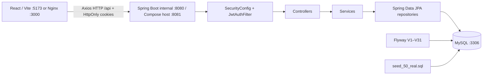

# Rewind — карта проєкту

Актуалізовано 19.10.2026 за кодом, локальними збірками, MySQL інтеграційними тестами, HTTP сценаріями та Figma inventory. Зовнішня папка `rewind-master` є обгорткою архіву; корінь Maven лежить тут. GitHub Actions CI вже описаний у `.github/workflows/ci.yml`, але production deployment на зовнішній інфраструктурі ще не виконаний. `target/`, frontend `dist/`, `node_modules/` і `test-results/` — локальні артефакти, а не вихідний код.

Надане замовником ТЗ збережено в [PROJECT_REQUIREMENTS.md](PROJECT_REQUIREMENTS.md), а порівняння вимог із кодом — у [REQUIREMENTS_TRACE.md](REQUIREMENTS_TRACE.md).

## 1. Що це і як частини спілкуються

Rewind — каталог фільмів із обліковими записами, особистими оцінками, відгуками та списками. Бекенд: Java 17, Spring Boot 4.0.1, Spring MVC, Security, JPA, MySQL, Flyway, JWT. Фронтенд: React 18, TypeScript, React Router 6, Axios, Vite 7.3.7. Дані для демо зібрані з TMDB у готовому SQL файлі.

| Де шукати | Призначення |
| --- | --- |
| `pom.xml`, `mvnw.cmd` | Залежності та запуск Maven/JDK 17 |
| `src/main/java/com/rewind/rewind/RewindApplication.java` | Вхідна точка Spring, при старті друкує кількість користувачів |
| `src/main/java/com/rewind/rewind/{auth,user,movie,list,rating,review,profile,admin,comment,message,notification,journal,producer,...}` | Функціональні модулі бекенду; у більшості є `controller`, `service`, `repo`, `entity`, `dto` |
| `src/main/java/com/rewind/rewind/security/` | Правила доступу, перевірка JWT, BCrypt |
| `src/main/resources/application.yml` | База, Flyway, JPA, пошта, JWT |
| `src/main/resources/db/migration/` | Послідовні SQL міграції V1–V31 |
| `src/main/resources/seed_50_real.sql`, `tmdb_seed_50.py` | Готове демо наповнення і його генератор |
| `letterboxd/letterboxd-login-figma-final2/src/App.tsx` | Реальні маршрути фронтенду |
| `letterboxd/letterboxd-login-figma-final2/src/api/` | Axios клієнт і виклики API |
| `letterboxd/letterboxd-login-figma-final2/src/context/AuthContext.tsx` | Вхід/вихід і перевірка сесії через HttpOnly cookies |
| `RUN_LOCAL.md` | Команди локального запуску, health/metrics і backup/restore |
| `scripts/backup-dev.ps1`, `scripts/restore-dev.ps1` | Відтворюваний дамп і відновлення MySQL |

### Ключові потоки

1. **Реєстрація:** `AuthController` → `UserService.register` перевіряє унікальність email/username, хешує пароль BCrypt, створює `USER`; `SystemListService` створює WATCHLIST, WATCHED і FAVORITES. Поле `displayName` спочатку дорівнює username.
2. **Вхід і доступ:** `UserService.login` перевіряє пароль і створює коротку cookie-сесію з відкличним refresh token. HttpOnly cookies додаються браузером автоматично; `JwtAuthFilter` на кожному запиті перевіряє access token, заново читає користувача з БД і бере актуальну роль/активність звідти.
3. **Каталог:** `MovieController` повертає сторінку карток, `MovieSearchController` будує JPA specification для назви, року, мінімальної оцінки, жанру й сортування. `MovieDetailsService` збирає жанри, режисерів, продюсерів, акторів, зовнішні оцінки, схожі фільми й прапорці поточного користувача; `PersonController` віддає actor/director/producer filmographies.
4. **Власні дії:** системні списки зберігають переглянуте/бажане/улюблене. `RatingService` зберігає оцінку 1–5 і SQL запитом перераховує середнє в `movies.rating`. `ReviewService` створює текст+оцінку й синхронізує її з `ratings`.
5. **Профіль і адміністрування:** `ProfileService` читає власні списки та 10 останніх оцінок/відгуків, змінює display name/avatar/пароль. Адміністратор керує фільмами, користувачами й модерацією відгуків.

## 2. Дані й міграції

V1 створює 14 таблиць: `users`, `movies`, `actors`, `directors`, `genres`, зв'язки `movie_actors`, `movie_directors`, `movie_genres`, `lists`, `list_items`, `reviews`, `ratings`, `external_ratings`, `similar_movies`. Основні зв'язки: один користувач має списки/відгуки/оцінки; один список має елементи з фільмами; фільм має жанри, акторів, режисерів, зовнішні оцінки та зв'язки зі схожими фільмами.

| Міграція | Ефект |
| --- | --- |
| `V1__baseline.sql` | Базова схема та ключі; `ratings` має унікальну пару `(user_id, movie_id)`, `list_items` — `(list_id, movie_id)` |
| `V2__baseline.sql` | Умовно додає `movies.imdb_id` і `trailer_url`, якщо їх немає; у новій схемі V1 вони вже є |
| `V3__add_display_name_to_users.sql` | Додає `users.display_name` |
| `V4__align_reviews_and_ratings.sql` | Додає оцінку й поля модерації до `reviews`, TMDB до enum зовнішніх оцінок, розширює точність `movies.rating` |

`spring.jpa.hibernate.ddl-auto=validate`: Hibernate перевіряє схему, але не створює її. Flyway запускається при старті. SQL seed не є міграцією: його треба імпортувати окремо. Він містить 50 фільмів, жанри, акторів, режисерів, 50 зовнішніх TMDB оцінок і зв'язки; `similar_movies` та producer credits він не наповнює — продюсери з'являються під час TMDB sync. Стан локальної БД змінюється інтеграційними та browser fixtures, тому кількість рядків не є сталою; під час останньої backup/restore перевірки було 182 фільми, 428 користувачів і застосовано Flyway V1–V31. `movies.rating` у seed-фільмів початково `null`, бо це середнє **користувацьких** оцінок, а TMDB зберігається окремо. V28 додає каскадні public social links користувача, V29 — направлені блокування користувачів, V30 — вподобання public lists, V31 — producer credits.

Генератор `tmdb_seed_50.py` звертається до TMDB `/configuration`, `/movie/popular`, деталей і credits; він формує `seed_50_real.sql`. Ключ не зберігається у репозиторії: генератор читає `TMDB_API_KEY` з environment і завершується з помилкою, якщо змінну не задано. Синтаксис перевірено на Python 3.11; готовий `seed_50_real.sql` дозволяє відтворити локальне демо без зовнішнього TMDB-запиту.

## 3. Повна карта HTTP API

Помилки API мають стабільний JSON-контракт `timestamp`, `status`, `error`, `message`, `path`, який формує `config/ApiExceptionHandler`.

Запущений `/v3/api-docs` показує **156 операцій у 127 paths**. `P` = без токена, `U` = потрібен користувач, `A` = потрібен ADMIN. Позначення відображають фактичний `SecurityConfig`, а не коментарі в контролерах. Для сторінок відповідь — Spring `Page` з масивом `content`, метаданими сторінки й `totalElements`.

| Доступ | Метод і шлях | Призначення |
| --- | --- | --- |
| P | `POST /api/auth/register`, `POST /api/auth/login` | Створення користувача; JWT |
| P | `GET /api/movies`, `GET /api/movies/search`, `GET /api/movies/{id}` | Каталог, пошук, деталі |
| U | `GET /api/movies/{id}/details`, `GET /api/movies/{movieId}/status/me` | Деталі-аліас; власні прапорці та оцінка |
| P | `GET /api/actors/{id}`, `GET /api/directors/{id}`, `GET /api/producers/{id}` | Публічна filmography з sort/genreId; movie details links to all three crew types |
| U | `POST`, `DELETE /api/movies/{movieId}/watchlist` | Додати/забрати зі списку бажаного |
| U | `POST`, `DELETE /api/movies/{movieId}/watched` | Позначити/скасувати перегляд |
| U | `POST`, `DELETE /api/movies/{movieId}/favorite` | Додати/забрати з улюбленого |
| U | `PUT`, `DELETE /api/movies/{movieId}/rating`; `GET /api/movies/{movieId}/rating/me` | Власна оцінка |
| P/U | `GET`, `POST /api/movies/{movieId}/reviews` | Гостьовий список видимих відгуків і захищене створення |
| U | `PATCH`, `DELETE /api/reviews/{reviewId}` | Зміна/видалення власного відгуку |
| U/P | `GET /api/lists/my`, `GET /api/lists/public`, `POST /api/lists` | Власні списки, гостьовий каталог публічних списків, створення |
| P | `GET /api/lists/public/popular`, `/recently-liked`, `/team` | Популярні, нещодавно вподобані та HQ/team public-list feeds |
| U | `GET /api/lists/public/{listId}/like-status`; `POST`, `DELETE /api/lists/{listId}/likes` | Статус і зміна вподобання public list |
| U | `PATCH /api/lists/{listId}` | Зміна свого CUSTOM списку |
| U | `GET`, `POST /api/lists/{listId}/items`; `DELETE /api/lists/{listId}/items/{movieId}` | Елементи власного списку |
| U | `PUT /api/lists/{listId}/items/reorder` | Порядок елементів CUSTOM списку |
| U | `POST /api/lists/{listId}/movies`; `DELETE /api/lists/{listId}/movies/{movieId}` | Аліаси для frontend клієнта |
| U | `GET`, `PATCH /api/profile/me`; `PUT /api/profile/me/password`; `DELETE /api/profile/me`; `GET`, `PUT /api/profile/me/social-links` | Власний профіль, social-links CRUD, зміна пароля та захищене видалення акаунта з відкликанням сесій |
| U | `GET /api/profile/me/watched`, `/watchlist`, `/favorites` | Сторінки власних системних списків |
| P/U | `GET /api/users/{id}`, `GET /api/users/me` | Публічний профіль; `/me` потребує авторизації й без токена повертає 401 |
| A | `GET`, `POST /api/admin/movies`; `PUT`, `DELETE /api/admin/movies/{id}` | Сторінковий список, створення, редагування, видалення фільму; dashboard має CRUD-форму |
| A | `GET /api/admin/users`, `GET`, `PATCH /api/admin/users/{id}` | Пошук, перегляд, USER/ADMIN role select і редагування користувачів; dashboard підтримує guard-овані activate/deactivate |
| A | `POST /api/admin/users/{id}/activate`, `/deactivate` | Активація/деактивація |
| A | `GET /api/admin/reviews`; `POST /api/admin/reviews/{id}/hide`, `/unhide`; `DELETE /api/admin/reviews/{id}` | Модерація відгуків; UI підключено до dashboard |
| A | `GET /api/admin/moderation/queue` | Об'єднана сторінкова черга немодерованих оглядів і коментарів |
| P | `GET /api/journal/articles?category=...&year=...&month=...`, `GET /api/journal/articles/archive`, `GET /api/journal/articles/{slug}` | Публічний журнал із мовним fallback, фільтром розділу, архівом і навігацією за місяцями |
| A | `GET`, `POST`, `PUT /api/admin/journal/articles` | Редактор і публікація статей із аудитом |
| A | `GET /api/admin/dashboard`, `GET /api/admin/audit-logs` | Лічильники та журнал адміністративних дій |
| A | `GET /api/admin/comments`; `POST /api/admin/comments/{id}/hide`, `/unhide`; `DELETE /api/admin/comments/{id}` | Модерація коментарів; UI підключено до dashboard |
| A | `GET /api/admin/lists`; `PUT /api/admin/lists/{id}/visibility?visible=...` | Сторінковий список списків з кількістю фільмів; приховування/публікація з аудитом; UI підключено до dashboard |
| A | `GET/DELETE /api/admin/conversations`, `GET/DELETE /api/admin/notifications` | Сторінковий адміністративний огляд і audit-видалення діалогів та сповіщень без email і службових полів; UI підключено до dashboard |
| A | `GET /api/admin/settings`, `PUT /api/admin/settings/{key}` | Whitelist налаштувань сайту з аудитом; UI підключено до dashboard |
| U | `GET`, `POST /api/conversations`; `GET`, `POST /api/conversations/{id}/messages`; `POST /api/conversations/{id}/read` | Приватні діалоги й повідомлення; blocked pairs не можуть почати/читати/надсилати |
| U | `GET /api/users/{id}/block-status`, `POST/DELETE /api/users/{id}/block` | Перевірка, встановлення й зняття блокування; блок також прибирає взаємні follow |
| U | `GET`, `PUT /api/notifications/preferences` | Налаштування сповіщень |

Пошук приймає `q`, `genreId`, `tag`, `year`, `minRating`, `sort`, `page`, `size`. Сортування: `newest`, `oldest`, `rating_desc`, `rating_asc`, `title_asc`; search обмежує розмір сторінки до 1–50. Базовий каталог сортує за ID спадно. DTO запитів і відповідей лежать поряд із відповідними модулями; ключові форми: реєстрація `{username,email,password}`, оцінка `{rating}`, відгук `{content,rating}`, створення списку `{name,description,isPublic}`, перестановка `{orderedItemIds}`.

Операційні endpoint-и: `GET /actuator/health` і `/actuator/health/{liveness|readiness}` відкриті для перевірки сервісу; `/actuator/metrics` потребує авторизації. У Compose Redis вмикається через `SPRING_CACHE_TYPE=redis`, а локальні тести використовують `spring.cache.type=none`.

Без авторизації поточний API повернув 200 для каталогу, пошуку, деталей, `/api/lists/public`, `/api/movies/1/reviews` та OpenAPI; `/api/profile/me` і `/api/users/me` повернули 401. Ці статуси перевірені HTTP запитами; інші операції звірені з контролерами та security rules, але не проходили окремий наскрізний сценарій.

## 4. Фронтенд: що видно в браузері

> **Current-state note (19.10.2026).** Актуальні локалізовані routes і component mapping наведені вище та в `docs/FIGMA_HANDOFF.md`. Таблиці нижче збережені як історичний baseline початкового аудиту; твердження про відсутні Movie Details, Profile, Lists, Home, reset-password або admin UI не описують поточний worktree.

`main.tsx` монтує `BrowserRouter` + `AuthProvider` + `App`. У `App.tsx` є тільки такі маршрути:

Актуальні локалізовані маршрути мають префікс `/uk` або `/en`: `/home`, `/films`, `/films/:id`, `/profile`, `/lists`, `/lists/discover`, `/lists/public/:id`, `/users/:id`, `/community`, `/people/:type/:id`, `/notifications`, `/messages`, `/journal`, `/journal/:slug`, `/admin`, а також auth-маршрути. Старі URL перенаправляються на `/uk/...`.

Для майбутнього перенесення макетів, поточного вигляду екранів і відповідності Figma фреймів файлам див. [FIGMA_HANDOFF.md](FIGMA_HANDOFF.md).

| URL | Компонент | Стан |
| --- | --- | --- |
| `/` | redirect | Перекидає на `/films` |
| `/films` | `Search` | Завантажує першу сторінку каталогу й шукає за назвою; картки не відкривають деталі, пагінації в UI немає |
| `/login` | `Login` | Викликає `/auth/login`, зберігає JWT, переводить на `/films` |
| `/register` | `Register` | Викликає `/auth/register`; після успіху пропонує перейти на login |
| `/forgot-password` | `ForgotPassword` | Форма є, але `/auth/forgot-password` у бекенді відсутній |

`Header` показує Films, Journal та login/register або logout; для ADMIN доступна адмін-панель. Logout відкликає cookie-сесію. `Footer` має декоративні посилання без `href`. Логотип фактично зберігається як `public/logo.png.png`, і компоненти звертаються саме до нього. Font Awesome підключено з CDN у `index.html`.

| Написаний, але не підключений код | Стан контракту з API |
| --- | --- |
| `pages/Profile.tsx` + `api/profile.api.ts` | Профіль підключений до `GET/PATCH /profile/me` і `PUT /profile/me/password`; публічні колекції та статистика читаються окремо |
| `pages/UserLists.tsx` + `api/lists.api.ts` | `/lists`, `/lists/discover`, `/lists/public/:id` підключають власні й публічні списки, теги та порядок елементів |
| `pages/MovieDetails.tsx` + `api/ratings.api.ts` | Оцінка працює на сторінці фільму; відсутня оцінка нормалізується як `null` |
| `pages/Comments.tsx` + `api/comments.api.ts` | Коментарі відображаються в контексті огляду; публічний список виключає приховані модерацією записи |
| `auth/ForgotPassword.tsx` + `auth/ForgotPassword.module.css` | Робочий сценарій використовує `POST /auth/forgot-password` і одноразовий reset token |

Axios бере base URL із `VITE_API_URL` із fallback на `http://localhost:8080/api` для прямого Vite-запуску; Compose proxy використовує внутрішній API `api:8080`, який публікується на host як `127.0.0.1:8081`. Авторизація працює через HttpOnly cookies і `/users/me`. `tsconfig.json` має `strict: false`; команда `vite build` сама не запускає `tsc`, тому обидві перевірки виконуються окремо.

## 5. Локальний стан і перевірки

На цьому комп'ютері є JDK 17; Compose використовує MySQL 8.4 (host `3307` → container `3306`), API host `8081` → container `8080`, Web host `3000` → Nginx `80`, а прямий Vite-запуск — `5173`. Команди перезапуску й локальні змінні середовища — у `RUN_LOCAL.md`. Без них конфігурація БД у `application.yml` може не збігатися з Docker користувачем.

| Перевірка | Фактичний результат |
| --- | --- |
| Frontend type/build | `npx tsc --noEmit` і `npm run build` green; Vite **170 modules** |
| Backend regression | Maven + Compose MySQL: **69 tests, 0 failures, 0 errors, 0 skipped** у 37 classes |
| Browser regression | Playwright **40 tests: 28 passed, 12 skipped, 0 failed**; admin headed **12/12** |
| API/schema | **156 operations / 127 paths**; **38 tables / 55 FKs** |
| Responsive matrix | 320/393/768/1440 px, `0 px` overflow і без page errors на перевірених маршрутах |
| Backup/restore | **188 movies / 448 users / 31 migrations**, тимчасові дані очищено |

Поточні деталі й timestamps зібрані у [RELEASE_EVIDENCE.md](RELEASE_EVIDENCE.md). `API_AUDIT.md` зберігає історичний audit старих DELETE-проблем; актуальні contract/regression checks підтверджують, що ці дефекти виправлені.

## 6. Конкретні проблеми та межі поточного стану

1. **Редакційний контент:** runtime ще не містить опублікованих UK/EN статей та archive entries; UI має чесні empty/fallback стани, але реальні обкладинки, аудіо, дати й переклади ще треба надати.
2. **Figma parity:** browser frames інвентаризовані, але Figma MCP view-only повертає `don't have edit access`; тому заявляється visual alignment, не pixel-perfect parity.
3. **Production:** потрібні rotation старого TMDB key, production TMDB/SMTP credentials, `.env.production`, VPS, domain, HTTPS, scheduler, monitoring і production backup/restore drill.
4. **Performance:** локальні N+1/contract checks зелені; production-like load/profile audit ще не є release evidence.

Ця карта потрібна як точка входу для наступних змін: спочатку вибрати користувацький сценарій, потім звірити його React компонент/API клієнт → контролер/DTO → сервіс/репозиторій → таблиці/міграції → реальна HTTP поведінка. Межі й невизначеність наведені прямо, щоб не сприймати сам факт компіляції за завершення функції.
